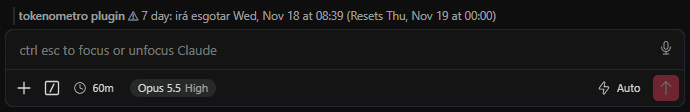
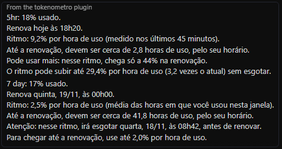

# Tokenômetro

**Saiba antes se o seu limite do Claude Code vai acabar.**

O Claude Code mostra quanto do limite você já usou. O Tokenômetro mostra para onde você está indo: mede o seu ritmo de uso e avisa, com dia e hora, se nesse ritmo o limite vai acabar antes de renovar. Assim dá tempo de se programar, em vez de descobrir quando ele já acabou.

## Para quem é

Para quem usa o Claude Code no VS Code com um plano de assinatura (Pro, Max ou Team), que tem limite de uso de 5 horas e limite semanal. A extensão do Claude Code é instalada junto, se ainda não estiver. Depois de instalada, a previsão aparece também no Claude Code aberto pelo terminal, na mesma máquina.

## O que aparece

No VS Code, uma linha acima do campo de mensagem do Claude Code, depois do nome `tokenometro plugin`. No terminal, o aviso aparece na faixa logo acima do campo de mensagem, só quando um limite vai acabar antes de renovar; dentro dos limites, o estado fica discreto no fim da linha de dicas, abaixo do campo.

| Linha | O que quer dizer |
|---|---|
| `Uso de tokens dentro dos limites` | No seu ritmo, nenhum limite acaba antes de renovar. |
| `⚠ 5h: irá esgotar 11:40 (renova 13:10)` | O limite de 5 horas acaba às 11:40, mas só renova às 13:10. |
| `⚠ 7 dias: irá esgotar qui, 19/11 às 15:00 (renova sex, 20/11 às 00:00)` | O limite semanal acaba na quinta às 15:00, mas só renova na sexta. |
| `⚠ 5h: esgotado (renova 18:20)` | O limite de 5 horas já acabou e volta às 18:20. |

Por padrão, tudo em português, com a hora em 24 horas. O fuso segue a configuração `timeZone` do Claude Code, e a hora só sai em 12 horas se o `timeFormat` dele estiver em `12-hour`.

Prefere inglês? Rode o comando **Tokenômetro: Mudar idioma** ou mude a configuração **Tokenômetro: Idioma**. A linha passa a seguir o painel de uso do Claude Code (`⚠ 5hr: runs out at 11:40 AM (Resets 1:10 PM)`), e o comando vira `/limit`.

Quando a previsão passa a dizer que um limite vai acabar, aparece também um aviso na tela, uma vez só:

> Atenção: se continuar nesse ritmo, o limite semanal irá esgotar quinta, 19/11, às 15h00.
> Ele só renova sexta, 20/11, às 00h00.

Digite `/limite` no Claude Code para ver o detalhe na conversa: quanto já foi usado, o ritmo por hora de uso, quando renova e até quanto o ritmo pode subir ou precisa cair para chegar à renovação.

## Exemplos

| Situação | O que aparece | O que dá para fazer |
|---|---|---|
| Segunda de manhã, uso normal | `Uso de tokens dentro dos limites` | Nada. Siga trabalhando. |
| Refatoração pesada: o limite de 5 horas sobe rápido | `⚠ 5h: irá esgotar 11:40 (renova 13:10)` | Deixe as tarefas pesadas para depois das 13:10 ou use sessões mais curtas até lá. |
| Quarta-feira, a semana já foi intensa | `⚠ 7 dias: irá esgotar qui, 19/11 às 15:00 (…)` | Distribua o uso: dias mais leves agora, prioridade para o que é urgente. |
| Sexta à tarde, com bastante uso na semana, mas você não trabalha no fim de semana | `Uso de tokens dentro dos limites` | Nada. O fim de semana em que você não usa não entra na conta. |
| Segunda de manhã, a semana do limite acabou de renovar | Previsão já disponível | A previsão usa o ritmo da semana anterior até ter dados da semana nova. |
| Você reabriu o VS Code | A última previsão continua na tela | Ela se atualiza com a próxima resposta do Claude Code. |

## Como a previsão é calculada

- **Percentual oficial:** o quanto você já usou de cada limite vem do próprio Claude Code, que recebe esse número a cada resposta.
- **Ritmo por hora de uso:** a extensão aprende em que horas você costuma trabalhar. No começo, supõe dias úteis das 8h às 18h. Noites e fins de semana em que você não usa não contam, então o horário previsto cai dentro do seu expediente.
- **Limite de 5 horas:** vale o ritmo dos últimos 45 minutos, que reage quando você acelera ou para.
- **Limite semanal:** vale a média das horas de uso desde o começo da semana do limite.
- **Hora e fuso:** o fuso segue a configuração `timeZone` do Claude Code. Em português, a hora sai em 24 horas, ou em 12 horas se o `timeFormat` dele estiver em `12-hour`; em inglês, segue o painel de uso do Claude Code.

## Instalação

1. Instale pelo [Visual Studio Marketplace](https://marketplace.visualstudio.com/items?itemName=lucasatz.tokenometro) ou, no VS Code, pela aba Extensões, buscando **Tokenômetro**.
2. Na janela que aparece, clique em **Instalar**. A extensão instala no Claude Code o plugin que faz o cálculo.
3. Abra uma nova sessão do Claude Code. A previsão aparece depois da primeira resposta.

O que é alterado na sua máquina:

- O plugin é copiado para `~/.claude/tokenometro/plugin`.
- Essa pasta é adicionada em `CLAUDE_CODE_PLUGIN_DIRS`, no `~/.claude/settings.json`. Antes, é feita uma cópia de segurança em `settings.json.tokenometro.bak`.
- A previsão é gravada em `~/.claude/tokenometro/previsao.json`, e as opções do Tokenômetro em `~/.claude/tokenometro/config.json`.

O comando **Tokenômetro: Remover plugin do Claude Code** desfaz tudo isso.

## Comandos

Pela paleta de comandos (Ctrl+Shift+P):

- **Tokenômetro: Instalar plugin no Claude Code**
- **Tokenômetro: Remover plugin do Claude Code**
- **Tokenômetro: Mostrar previsão de uso**
- **Tokenômetro: Mudar idioma (Change language)**

## Configuração

- **Tokenômetro: Idioma** (português do Brasil por padrão): idioma da linha, do aviso na tela e do comando `/limite`. Em inglês, o comando vira `/limit`. A troca vale a partir da próxima resposta do Claude Code; o nome do comando muda na próxima sessão.
- **Tokenômetro: Abrir Painel Ao Iniciar** (desligada por padrão): abre o painel do Tokenômetro toda vez que uma sessão começa, no lugar da linha junto ao campo de mensagem. No VS Code e no terminal em tela cheia, ele fica numa coluna ao lado da conversa; no terminal comum, acima do campo de mensagem, com uma linha de altura. A mudança vale a partir da próxima sessão.
- **Tokenômetro: Barra De Status** (desligada por padrão): mostra a previsão também na barra de status do VS Code.

## Limitações

- Prevê os limites de 5 horas e semanal. O limite por modelo (como o do Fable) não chega aos plugins do Claude Code, então ainda não é previsto.
- A previsão só se atualiza com o Claude Code em uso, porque o percentual chega junto com as respostas.
- Uso feito fora do Claude Code, como no claude.ai pelo navegador, consome o mesmo limite mas não entra como hora de uso. Se você usa muito por lá, o ritmo calculado sai um pouco mais alto.
- O plugin usa o recurso de plugins do Claude Code, que está em acesso antecipado e pode mudar em versões futuras. Testado com o Claude Code 2.1.322 no VS Code.
- Considera as configurações do Claude Code na pasta padrão (`~/.claude`). Quem muda essa pasta com a variável `CLAUDE_CONFIG_DIR` precisa instalar o plugin à mão.

## Privacidade

Nada sai da sua máquina. A extensão não tem servidor e não coleta dados: ela usa apenas o que o Claude Code já recebe.

## Desenvolvimento

| Pasta ou arquivo | O que é |
|---|---|
| `extension.js` | Extensão do VS Code: instala e atualiza o plugin e, se ligada, mostra a previsão na barra de status. |
| `plugin/` | Plugin do Claude Code que calcula a previsão, mostra a linha no painel e grava `previsao.json`. |
| `plugin/hooks/previsao.ts` | O cálculo: ritmo por hora de uso, horário aprendido e textos. |
| `ferramentas/gerar-icone.ps1` | Gera o ícone (Windows, PowerShell). |

- Testes do plugin: `claude plugin test plugin`
- Validação do plugin: `claude plugin validate plugin`
- Pacote da extensão: `npx @vscode/vsce package`

## Sugestões e problemas

Abra uma [issue no GitHub](https://github.com/lucasatz/tokenometro/issues). Para problemas, informe a versão do Claude Code e, se puder, o texto que aparece no `/limite`.

## Licença

[MIT](LICENSE)

---

Projeto independente, sem vínculo com a Anthropic. Claude e Claude Code são marcas da Anthropic.
